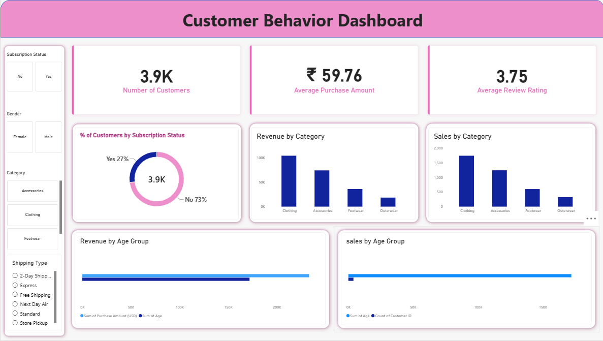

# 🛍️ Customer Shopping Behavior Analysis

## 📌 Project Overview

This project analyzes customer shopping behavior using transactional data from **3,900 purchases** across multiple product categories.  

The main objective is to uncover insights into:

- Spending patterns  
- Customer segmentation  
- Product preferences  
- Subscription behavior  
- Revenue contribution  

These insights help guide strategic business decisions and marketing optimization.

---

## 📊 Dataset Summary

- **Total Rows:** 3,900  
- **Total Columns:** 18  

### 🔑 Key Features

**Customer Demographics**
- Age  
- Gender  
- Location  
- Subscription Status  

**Purchase Details**
- Item Purchased  
- Category  
- Purchase Amount (USD)  
- Season  
- Size  
- Color  

**Shopping Behavior**
- Discount Applied  
- Promo Code Used  
- Previous Purchases  
- Frequency of Purchases  
- Review Rating  
- Shipping Type  

### ⚠️ Missing Data
- 37 missing values in the `Review Rating` column

---

## 🐍 Exploratory Data Analysis (Python)

Data cleaning and preprocessing were performed using **Python (Pandas)**.

### ✔ Data Preparation Steps

- Imported dataset using `pandas`
- Used `df.info()` and `df.describe()` for initial exploration
- Handled missing values in `Review Rating` using **median rating per category**
- Standardized column names to **snake_case**
- Created new features:
  - `age_group` (binned age categories)
  - `purchase_frequency_days`
- Checked redundancy between `discount_applied` and `promo_code_used`
- Dropped `promo_code_used` column
- Loaded cleaned data into **PostgreSQL** for SQL analysis

---

## 🗄️ SQL Business Analysis (PostgreSQL)

Performed structured queries to answer business-driven questions:

### 1️⃣ Revenue by Gender
Compared total revenue generated by male vs female customers.

### 2️⃣ High-Spending Discount Users
Identified customers who used discounts but still spent above the average purchase amount.

### 3️⃣ Top 5 Products by Rating
Products with highest average review ratings:

1. Gloves – 3.86  
2. Sandals – 3.84  
3. Boots – 3.82  
4. Hat – 3.80  
5. Skirt – 3.78  

### 4️⃣ Shipping Type Comparison
Compared average purchase amount:

- Standard Shipping – 58.46  
- Express Shipping – 60.48  

### 5️⃣ Subscribers vs Non-Subscribers

| Subscription Status | Total Customers | Avg Spend | Total Revenue |
|---------------------|----------------|-----------|--------------|
| Yes | 1053 | 59.49 | 62,645 |
| No  | 2847 | 59.87 | 170,436 |

### 6️⃣ Discount-Dependent Products
Products with highest percentage of discounted purchases:

- Hat – 50.00%
- Sneakers – 49.66%
- Coat – 49.07%
- Sweater – 48.17%
- Pants – 47.37%

### 7️⃣ Customer Segmentation

Customers classified based on purchase history:

- Loyal – 3,116  
- Returning – 701  
- New – 83  

### 8️⃣ Top 3 Products per Category
Identified most purchased items within each product category.

### 9️⃣ Repeat Buyers & Subscription Behavior
Analyzed whether customers with more than 5 purchases are more likely to subscribe.

### 🔟 Revenue by Age Group

| Age Group | Total Revenue |
|-----------|--------------|
| Young Adult | 62,143 |
| Middle-aged | 59,197 |
| Adult | 55,978 |
| Senior | 55,763 |

---

## 📈 Power BI Dashboard

An interactive Power BI dashboard was created to analyze customer shopping behavior and present key insights through visualizations.

Dashboard Preview

Dashboard File

You can download the Power BI dashboard file below and explore it in Power BI Desktop.

[📥 Download Power BI Dashboard](Customer_Shopping_Analysis.pbix)

## 💡 Business Recommendations

### 🔹 Boost Subscriptions
Promote exclusive benefits and incentives to increase subscription adoption.

### 🔹 Customer Loyalty Programs
Reward repeat buyers to move them into the "Loyal" segment.

### 🔹 Optimize Discount Strategy
Balance discount-driven sales growth with profit margin control.

### 🔹 Product Positioning
Highlight top-rated and best-selling products in marketing campaigns.

### 🔹 Targeted Marketing
Focus marketing efforts on:
- High-revenue age groups
- Express shipping users
- Loyal customers

---

## 🛠️ Tech Stack

- **Python (Pandas, NumPy)**
- **PostgreSQL**
- **Power BI**
- **SQL**

---

## 📂 Project Workflow

1. Data Collection  
2. Data Cleaning & Feature Engineering (Python)  
3. Database Integration (PostgreSQL)  
4. Business Analysis (SQL Queries)  
5. Data Visualization (Power BI Dashboard)  
6. Business Insights & Recommendations  

---

## 🚀 Key Outcomes

- Identified revenue-driving customer segments  
- Discovered discount-dependent products  
- Evaluated subscription performance  
- Built an interactive executive-level dashboard  
- Provided actionable business recommendations  

---
